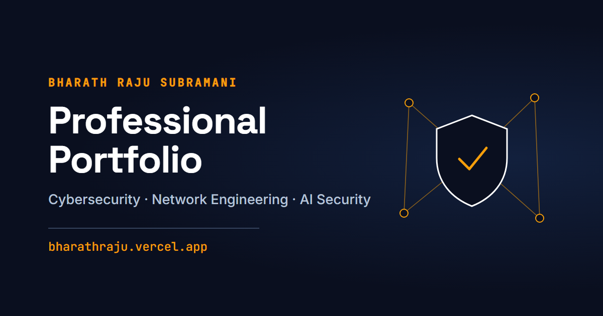

# Bharath Raju Subramani — Portfolio

Personal portfolio for Bharath Raju Subramani — Cybersecurity Engineering, Network Security and Infrastructure & AI Security, Sydney NSW.

**Live site:** https://bharathraju.vercel.app/

A single static page built with plain JavaScript — no framework, no build step.



## Featured projects

| Project | Status |
| --- | --- |
| AgentOne — Agentic AI Penetration Testing | Academic research prototype, 2026 |
| Cyber Incident Investigation & Response | Simulated academic case study, 2026 |
| EdgeClosure — B2B Network Security Platform | Planning & architecture, 2026–present |
| DeceptID — AI-Powered Identity Security Platform | Early development, 2026–present |

Diagrams, network maps and dashboards on the site are illustrative graphics, not live production telemetry.

## Files

| File | What it is |
| --- | --- |
| `js/data.js` | ✏️ **All the content** — edit this file to update the site |
| `js/render.js` | Builds every section of the page from `data.js` |
| `js/graphics.js` | SVG illustrations: hero network map, career path, project art, tool tiles |
| `js/logos.js` | Tool logos (shape data from [Simple Icons](https://simpleicons.org), CC0) |
| `js/main.js` | Interactions: nav, scroll reveal, static stat cards (no count-up), terminal typing, name "decrypt", network background with blocked threats |
| `css/style.css` | All styles |
| `index.html` | Page shell, SEO tags and script loading |
| `resume.pdf` | Résumé served by the "Download résumé" buttons |
| `portfolio-featured.png` | Open Graph / social preview image (1200×630) |
| `og-image.png` | Additional preview image |
| `sitemap.xml`, `robots.txt` | Search engine files |

## Run locally

```bash
python -m http.server 5173
```

Then open http://localhost:5173.

## Deploy on Vercel

1. Import this repository in Vercel.
2. Framework preset: **Other**. Leave the build command empty and the output directory as the root.
3. The production URL is `https://bharathraju.vercel.app/`. The `canonical` link and Open Graph tags in `index.html` already point to it, and `og:image` uses `portfolio-featured.png`.

## Updating

- **Résumé:** replace `resume.pdf` with the new file (keep the same name).
- **Content:** open `js/data.js` — jobs, projects, skills, certifications and contact details are plain lists. Add an item to a list and it appears on the page.
  - `**text**` makes text bold; a tag starting with `*` (e.g. `"*Python"`) is shown as a core skill.
  - The first project with `featured: true` gets the large card with the diagram.
- **Colours:** change the variables in `:root` at the top of `css/style.css` (dark navy background `#0A0F1F`, amber accent `#F59E0B`).
